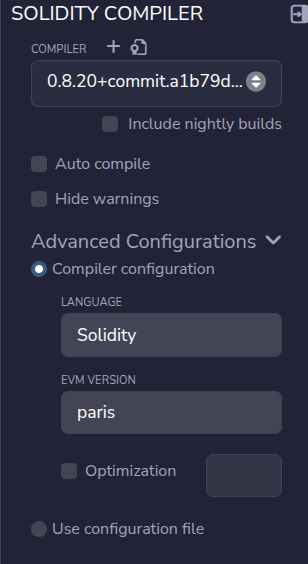
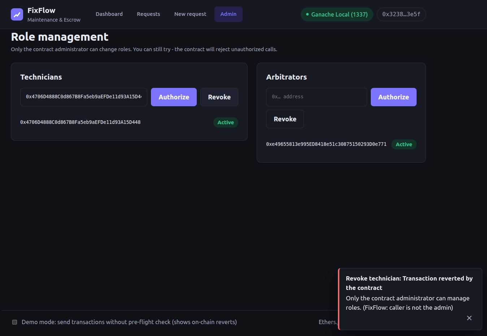

# FixFlow – Blockchain Maintenance Requests with Escrow

FixFlow is a decentralized application (DApp) for apartment maintenance. Tenants create repair requests and lock the agreed payment in a smart-contract escrow. Technicians accept and complete the work. Payment is released only when the tenant approves, when a timeout rule applies, or when an authorized arbitrator settles a dispute.

*Blockchain Technology IA2 assignment project.*

### Deployment details

| Item | Value |
|---|---|
| Deployment network | **Ganache Local** (local Ethereum), chain ID **1337**, RPC `http://127.0.0.1:7545` |
| Deployed contract address | **`0xb8604a08d0402ceC11e48F2804F6FD37b6edBDDF`** |
| Deployed with | Remix IDE + MetaMask, Solidity 0.8.20, EVM version `paris`, optimizer off |
| Constructor arguments | `_reviewPeriod = 300` s, `_disputeTimeout = 600` s |
| Admin (deployer) | `0x389Ca5357F84393eCCE995a7768a9780e1D20D88` |
| Deployment date | 2026-10-17 |

Full deployment record (block numbers, role-setup transactions): [deployment/deployment-info.md](deployment/deployment-info.md#deployment-record). Ganache is a local chain, so this address only exists on the machine where it was deployed. To run the project elsewhere, redeploy and update `frontend/config.js` (section 6).

---

## 1. The problem

Maintenance in rented apartments often leads to disputes:
- *Tenant:* "I reported it weeks ago and nobody came." / "I paid and the job was never finished."
- *Technician:* "I did the work, but I was never paid."
- *Property manager:* "There is no record of who agreed to what, and when."

FixFlow solves this with a shared, tamper-evident record and a neutral escrow:
- Every request, acceptance, completion, approval and dispute is recorded on-chain with the actor and a timestamp.
- The money is locked in the contract up front, so the technician knows the funds exist. Nobody can take them without satisfying the contract's rules, not even the administrator.
- Deadlines and timeouts guarantee that funds can never be locked forever because someone stops responding.

## 2. Features

| Area | Features |
|---|---|
| Smart contract | Role-based access (admin, technicians, arbitrators); create + fund in one transaction; full lifecycle state machine; tenant approval; disputes with fixed arbitration outcomes; cancellation and decline refunds; deadline refunds; review-period auto-payout; dispute-timeout default split; pull-payment withdrawals; reentrancy guard; on-chain history per request; events for every change |
| Frontend | MetaMask connect; account/network change detection; wrong-network warning with a *Switch network* button; live dashboard (total, open and completed requests, outstanding escrow, recent activity); request list with filters and search; request detail with escrow/completion/payment/dispute status, on-chain history and tx hashes; role- and state-aware action buttons; role management; pending/success/failure toasts with tx hashes; readable explanations of reverts and user rejections; demo mode that sends transactions without pre-flight checks, to show on-chain reverts |

## 3. Architecture

```
┌───────────────────────────────┐         ┌─────────────────────────────┐
│  Browser (frontend/)          │         │  Ganache (local Ethereum)   │
│  index.html · style.css       │  reads  │  chain ID 1337, port 7545   │
│  app.js (vanilla JS)          │────────▶│                             │
│  ethers.js v6 (vendored UMD)  │         │  ┌───────────────────────┐  │
│                               │  signed │  │  FixFlow.sol          │  │
│  MetaMask (EIP-1193 wallet) ──┼────────▶│  │  escrow + lifecycle   │  │
└───────────────────────────────┘   txs   │  └───────────────────────┘  │
          ▲  served by npm run serve      └─────────────────────────────┘
          │  (http://localhost:8080)                ▲
                                                    │ compiled & deployed with
                                              Remix IDE + MetaMask
```

- **No backend or database.** The contract is the single source of truth. The UI derives every figure from contract reads and event logs.
- **Reads** go through MetaMask when it is connected to the right chain, otherwise through `READ_RPC_URL`. They never ask for a signature.
- **Writes** are signed by the connected MetaMask account. A transaction is shown as successful only after its receipt is mined with `status = 1`.

### Request lifecycle (state machine)

```
                    accept (tech)            markCompleted (tech)
   createRequest ──▶ Open ───────────────▶ Accepted ───────────────▶ Completed
                     │  │                     │                       │   │
   cancel (tenant) / │  │ deadline passed     │ deadline passed       │   │ approve (tenant) or
   decline (tech)    │  │ claimRefund…        │ claimRefund…          │   │ review period over →
                     ▼  ▼                     ▼                       │   │ claimPayment… (tech)
                Cancelled  Refunded ◀─────────┘                       │   ▼
                                                                      │  Released
                                          raiseDispute (tenant, within review period)
                                                                      ▼
                                   Disputed ──resolveDispute (arbitrator)──▶ Resolved
                                            └─resolveExpiredDispute (party, after timeout)─┘
```
Final states: **Released, Cancelled, Refunded, Resolved**. Every final transition settles the escrow exactly once.

### Escrow rules

| Situation | Who may act | Outcome |
|---|---|---|
| Request created | Tenant | `msg.value` must equal `amount` exactly (> 0); technician must be authorized; deadline in the future (≤ 365 days) |
| Open, tenant changes mind | Tenant | **Cancelled**, 100 % refund to tenant |
| Open, technician refuses | Assigned technician | **Cancelled**, 100 % refund to tenant |
| Open/Accepted, deadline passed | Tenant | **Refunded**, 100 % to tenant; technician can no longer accept or complete |
| Completed, tenant approves | Tenant | **Released**, 100 % to technician |
| Completed, tenant silent past `reviewPeriod` | Assigned technician | **Released**, 100 % to technician; disputes are no longer allowed |
| Completed, tenant disputes within `reviewPeriod` | Tenant (reason required) | **Disputed**, funds frozen; normal approval/claim paths blocked |
| Disputed | Authorized arbitrator who is **not** a party | **Resolved**: `FavorTechnician` (100 % tech), `FavorTenant` (100 % tenant) or `Split` (50 % tech, remainder to tenant) |
| Disputed, no arbitrator within `disputeTimeout` | Tenant or technician | **Resolved** with `DefaultSplit` (same 50/50 split) |

**Pull payments:** settlements credit `pendingWithdrawals[account]`, and the recipient calls `withdraw()`. A recipient that cannot receive ETH therefore cannot block a settlement or corrupt accounting. The contract maintains `balance == totalEscrowed + totalPendingWithdrawals`, which the automated tests check.

**Admin powers:** manage technicians and arbitrators and transfer the admin role. The admin has **no** function that can move users' escrow.

## 4. Technology stack

| Technology | Version / use |
|---|---|
| Solidity | `^0.8.20`, compiled with 0.8.20, EVM version `paris` |
| Remix IDE | compilation and deployment (required workflow) |
| Ganache | local blockchain (GUI or CLI `ganache@7.9.2`), chain ID 1337 |
| MetaMask | wallet / transaction signing |
| Ethers.js | **6.13.4**, loaded as the official UMD build from `frontend/vendor/ethers-6.13.4.umd.min.js` (copied from the `ethers` npm package). It exposes `window.ethers` and needs no CDN or internet. The automated tests use the same npm version, so v5 and v6 APIs are never mixed |
| HTML5 / CSS3 / vanilla JS | frontend, no frameworks |
| Node.js (dev only) | `solc` (compile check), `ganache` (local chain + tests), static file server. These are not a smart-contract framework; Remix remains the deployment tool |
| Git / GitHub | version control |

## 5. Folder structure

```
FixFlow/
├── contracts/
│   ├── FixFlow.sol                 # the smart contract
│   └── test/RejectingReceiver.sol  # test-only helper (ETH-refusing / re-entrant tenant) – not deployed
├── frontend/
│   ├── index.html                  # UI markup
│   ├── style.css                   # styles (light/dark, responsive)
│   ├── app.js                      # wallet, contract reads/writes, rendering
│   ├── config.js                   # contract address, chain ID, RPC URL, ABI
│   └── vendor/ethers-6.13.4.umd.min.js
├── deployment/deployment-info.md   # Remix + Ganache + MetaMask guide and deployment record
├── tests/
│   ├── test-cases.md               # test plan, expected and observed results
│   └── automated/fixflow.test.js   # automated contract tests (npm test)
├── scripts/
│   ├── compile.js                  # solc-js compile check -> build/ (git-ignored)
│   ├── sync-abi.js                 # writes the compiled ABI into frontend/config.js
│   └── serve.js                    # zero-dependency static server for the frontend
├── screenshots/                    # deployment & UI evidence screenshots (see section 11)
├── package.json                    # dev scripts & dev dependencies
├── .gitignore
└── README.md
```

## 6. Setup

Prerequisites: Node.js ≥ 18, Git, a Chromium-based browser or Firefox with **MetaMask**, and Ganache (GUI, or the CLI included via npm).

```bash
git clone <your-repo-url> FixFlow && cd FixFlow
npm install          # dev tools: solc, ganache, ethers
npm run compile      # optional: verify the contract compiles (solc 0.8.20)
npm test             # optional: run the automated contract tests
```

### 6.1 Configure Ganache
- **GUI:** new workspace, port **7545**, chain ID **1337** (the GUI shows network ID 5777, which is fine). Save the workspace so your chain persists.
- **CLI:** `npm run ganache` (port 7545, chain ID 1337, deterministic accounts). Keep this terminal open.

### 6.2 Connect MetaMask
Add a network: RPC `http://127.0.0.1:7545`, chain ID `1337`, symbol `ETH`. Import Ganache accounts by private key for the roles **Admin** (account 0), **Tenant** (1), **Technician** (2) and **Arbitrator** (4). Details: [deployment/deployment-info.md](deployment/deployment-info.md#2-configure-metamask).

### 6.3 Compile & deploy through Remix
1. Paste `contracts/FixFlow.sol` into Remix. Select compiler **0.8.20**, *Advanced → EVM version* **paris**, then compile.
2. *Deploy & Run* → *Environment*: *Browser Extension → MetaMask* (older Remix: *Injected Provider – MetaMask*), with the Admin account on the Ganache network.
3. Constructor: `_reviewPeriod, _disputeTimeout` in seconds, e.g. `300,600` for a demo. Click **Deploy**.

Full step-by-step guide: [deployment/deployment-info.md](deployment/deployment-info.md).

### 6.4 Configure the ABI and address
In `frontend/config.js`, set `CONTRACT_ADDRESS` to the address Remix shows under *Deployed Contracts*. Optionally set `DEPLOYMENT_BLOCK`. `CHAIN_ID` (1337) and `READ_RPC_URL` must match your Ganache.
The ABI is already generated from the contract source. After changing the contract, run `npm run sync-abi`, or paste the ABI from Remix's compiler tab between the `ABI-START`/`ABI-END` markers.

### 6.5 Run the frontend
```bash
npm run serve        # http://localhost:8080
```
Opening `index.html` via `file://` will not work, because MetaMask does not inject into file pages. Any static server works, e.g. `python3 -m http.server 8080 -d frontend`.

## 7. Roles and workflow

| Role | Who | Can do |
|---|---|---|
| Admin | contract deployer | authorize/revoke technicians and arbitrators; transfer admin |
| Tenant | any address that creates a request | create & fund, cancel (before acceptance), approve, dispute, claim refund after deadline, apply default split after dispute timeout, withdraw |
| Technician | admin-authorized address | accept/decline assigned jobs, mark completed, claim payment after review period, apply default split, withdraw |
| Arbitrator | admin-authorized address | resolve disputes they are not a party to |

**Demo script**
1. Admin → *Admin* tab → authorize the Technician and Arbitrator addresses.
2. Tenant → *New request* → description, amount, deadline, technician → *Create & fund* (MetaMask shows the ETH value).
3. Technician → *Requests* → open the request → *Accept job* → *Mark as completed*.
4. Tenant → open the request → *Approve work & release payment*, **or** *Raise dispute* with a reason.
5. (Dispute) Arbitrator → open the request → *Pay technician* / *Refund tenant* / *Split 50/50*.
6. Technician/Tenant → *Dashboard* → *Withdraw funds*.
7. Negative cases: switch to a wrong account and try actions (via Remix, or with the footer **Demo mode** toggle that sends without pre-flight checks). Expect clear revert messages.

The UI hides actions that do not apply to the connected account and state. The contract enforces every rule independently.

## 8. Testing

Testing was done at three levels. Full details are in [tests/test-cases.md](tests/test-cases.md).

| Level | Result |
|---|---|
| Automated contract tests (`npm test`, in-process Ganache) | **18/18 passed** (2026-10-16). Covers all contract scenarios, including timeouts and payment-failure handling |
| Browser UI checks with a mock wallet (headless Firefox + Ganache) | **52/52 checks passed** (2026-10-16) |
| Manual Remix + Ganache + MetaMask | **Executed 2026-10-17** on the deployment above. Evidence in [section 11](#11-screenshots) |

### Test cases: valid, invalid and unauthorised inputs

Observed results come from the manual MetaMask run unless marked *(automated)*. The automated runs (`npm test`) observed the exact revert messages listed.

| Type | Test case | Expected | Observed result |
|---|---|---|---|
| Valid | Tenant creates & funds a request (0.5 ETH, authorized technician, future deadline) | Tx confirmed, status Open, funds held in escrow | Request #2 mined in block 11, status **Open**, "Held in escrow" (Fig. 12–14) |
| Valid | Assigned technician accepts, then marks completed | Status Accepted → Completed | Both txs confirmed (block 12 for accept); on-chain history Open → Accepted → Completed (Fig. 15–19) |
| Valid | Tenant approves completed work | Payment released to technician | Request #1 approved; 0.5 ETH credited to the technician (Fig. 21 activity feed) |
| Valid | Tenant disputes, authorized arbitrator resolves | Funds frozen, then settled by a fixed outcome | Request #2 "Frozen (in dispute)"; arbitrator chose *Refund tenant*; escrow 0 ETH, tenant withdrawable 0.5 ETH (Fig. 20–21) |
| Invalid | ETH sent ≠ agreed amount, amount 0, past deadline | Revert | *(automated)* `deposit must equal the agreed amount`, `amount must be greater than zero`, `deadline must be in the future` |
| Invalid | Duplicate request ID / ID 0 | Revert | *(automated)* `request id already exists`, `id must be non-zero`; the UI also warns before sending |
| Invalid | Skipping states (complete before accept, approve an Open request, approve a disputed request) | Revert | *(automated)* `invalid request status`; in the UI, actions not valid in the current state are not offered (Fig. 14–20) |
| Invalid | Non-numeric amount / empty description in the form | Blocked by the frontend | *(UI check)* validation errors listed, nothing sent |
| Unauthorised | Non-admin changes roles | Revert | Tenant tried to revoke the technician; rejected with `FixFlow: caller is not the admin`, technician still Active (Fig. 22) |
| Unauthorised | Other technician / outsider accepts or completes a job | Revert | *(automated)* `caller is not the assigned technician` |
| Unauthorised | Technician or another tenant approves/disputes/cancels | Revert | *(automated)* `caller is not the tenant` |
| Unauthorised | Non-arbitrator (or an arbitrator who is a party) resolves a dispute | Revert | *(automated)* `caller is not an arbitrator`, `arbitrator is a party to this request` |

### Screenshot evidence checklist

| Required by the brief | Where |
|---|---|
| Smart contract compilation | Fig. 1, 6 |
| Smart contract deployment | Fig. 3, 5–8 |
| MetaMask wallet connection | Fig. 4 (Remix), Fig. 9 (FixFlow connected to *Ganache Local (1337)*) |
| Successful transaction | Fig. 7 (Remix receipt, status 1), Fig. 13–14, 17 |
| Failed transaction | Fig. 22 |
| Blockchain data displayed through the UI | Fig. 9, 10, 14, 17, 20, 21 |

## 9. Known limitations

- **Local demo scope.** Designed for Ganache. A public testnet would need a funded deployer, a different `CHAIN_ID` and `READ_RPC_URL`, and an event-log block range (`DEPLOYMENT_BLOCK`). Logs are read in one `eth_getLogs` call, which public RPCs may limit.
- **Public data.** Descriptions and dispute reasons are stored on-chain in plain text and are visible to everyone. Do not enter personal information.
- **Fixed arbitration outcomes.** Arbitrators can choose only 100/0, 0/100 or 50/50. No custom percentages, evidence upload or appeals.
- **Trusted roles.** The admin chooses technicians and arbitrators. Arbitrators are trusted to judge fairly; the contract only stops them from judging their own disputes.
- **Time.** Rules use `block.timestamp`. Ganache mines blocks only on transactions, and its timestamps follow your computer's clock.
- **Revocation.** Revoking a technician blocks *accepting* new jobs. A job already accepted can still be completed and paid.
- **Withdrawals.** Funds are credited first and must be withdrawn in a second transaction (pull-payment pattern, a deliberate security choice).
- **Request IDs.** IDs are chosen by the tenant (the UI suggests the next free one). Two tenants submitting the same ID at the same moment: the second transaction reverts.
- **Not audited.** This is a student project. Do not use it with real funds.

## 10. Publishing to GitHub

```bash
cd FixFlow
git init                          # if not already a repository
git add .
git status                        # check: no node_modules/, build/, private keys or .env files
git commit -m "FixFlow: maintenance escrow DApp"
git branch -M main
git remote add origin https://github.com/<your-username>/FixFlow.git
git push -u origin main
```
Before pushing:
- never commit private keys or seed phrases, including your MetaMask account keys
- check that `frontend/config.js` contains only the contract address, chain ID, RPC URL and ABI
- add the screenshots and fill in the deployment record and manual test results.

---

## 11. Screenshots

The screenshots below were taken while deploying FixFlow through Remix to Ganache (chain ID 1337) with MetaMask, then running a full maintenance workflow in the FixFlow UI. Request #2 ("termite issue", 0.5 ETH) goes through creation, acceptance, completion, a dispute and arbitration.

### 11.1 Deployment (Remix + MetaMask + Ganache)

**Figure 1 – Remix compiler settings:** Solidity 0.8.20 with EVM version `paris`.



**Figure 2 – Choosing the deployment environment:** the *Browser Extension → MetaMask* (injected provider) option in Remix's *Deploy & Run Transactions* tab.


**Figure 3 – Constructor arguments:** `_reviewPeriod = 300` seconds and `_disputeTimeout = 600` seconds entered before clicking **Deploy** (deployer account funded with 100 ETH on Ganache).


**Figure 4 – MetaMask connection to Remix:** MetaMask asks to connect the imported Ganache account to Remix.


**Figure 5 – Remix connected through MetaMask:** the deployer account and its balance after deployment.


**Figure 6 – Contract deployed on chain 1337:** FixFlow is compiled and deployed on the local network (Remix labels chain 1337 "Geth Testnet"). One deployed contract and three transactions appear in Remix.


**Figure 7 – Role setup transaction (Remix):** the admin calls `authorizeArbitrator(address)`. The transaction was mined in block 5 with status 1 (success), using 47,888 gas.


**Figure 8 – Emitted event:** the same transaction's decoded `ArbitratorAuthorized` event log and its raw log (topics, block number, transaction hash).


### 11.2 FixFlow user interface

**Figure 9 – Dashboard (admin view):** live contract data, i.e. total/open/completed requests, outstanding escrow, recent activity read from contract events, and contract details (address, admin, review period, dispute timeout). The wallet is connected to *Ganache Local (1337)*.


**Figure 10 – Role management (admin):** the authorized technician and arbitrator are listed as *Active*, read from the contract.


**Figure 11 – New maintenance request form:** the request ID is pre-filled with the next free ID, next to the escrow rules and safety nets.


**Figure 12 – Tenant fills in a request:** "termite issue", 0.5 ETH, a deadline, and the authorized technician's address.


**Figure 13 – Funding the escrow (MetaMask):** MetaMask asks the tenant to confirm a 0.5 ETH transaction to the FixFlow contract on Ganache Local. FixFlow shows "confirm in MetaMask".


**Figure 14 – Successful transaction:** request #2 is created (status **Open**, 0.5 ETH held in escrow). A toast confirms the transaction was mined in block 11 and shows its hash. The tenant only sees the *Cancel request* action.


**Figure 15 – Technician view of the request:** the assigned technician only sees *Accept job* and *Decline job* (role-based actions).


**Figure 16 – Technician accepts the job:** MetaMask transaction request for `acceptRequest`.


**Figure 17 – Job accepted:** status **Accepted**, completion "In progress". The on-chain history and transactions list now include `RequestAccepted` (mined in block 12).


**Figure 18 – Technician marks the work completed:** MetaMask transaction request for `markCompleted`.


**Figure 19 – Tenant raises a dispute:** the job is **Completed** and the 5-minute review period is shown. The tenant enters the reason "work not completed" and confirms *Raise dispute (freeze funds)* in MetaMask.


**Figure 20 – Arbitrator resolves the dispute:** the request is **Disputed** and the escrow is frozen. The arbitrator sees the three fixed outcomes and the arbitrator deadline, then confirms *Refund tenant (100%)* in MetaMask. The on-chain history shows Open → Accepted → Completed → Disputed.


**Figure 21 – Dashboard after settlement and withdrawal:** both requests are completed and outstanding escrow is 0 ETH. The tenant's refunded 0.5 ETH appears as a withdrawable balance, and the tenant confirms *Withdraw funds* in MetaMask.


### 11.3 Failed transaction / unauthorized operation

**Figure 22 – Unauthorized role change rejected:** the tenant account (`0x3238…3e5f`), which is not the administrator, tries to **revoke the technician**. The contract rejects the call with `FixFlow: caller is not the admin`, and FixFlow explains it as "Only the contract administrator can manage roles." Demo mode was off, so the revert was caught by the pre-flight gas estimate: no transaction was mined, no gas was spent, and the technician stays *Active*.


